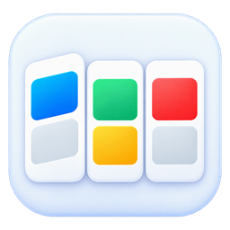
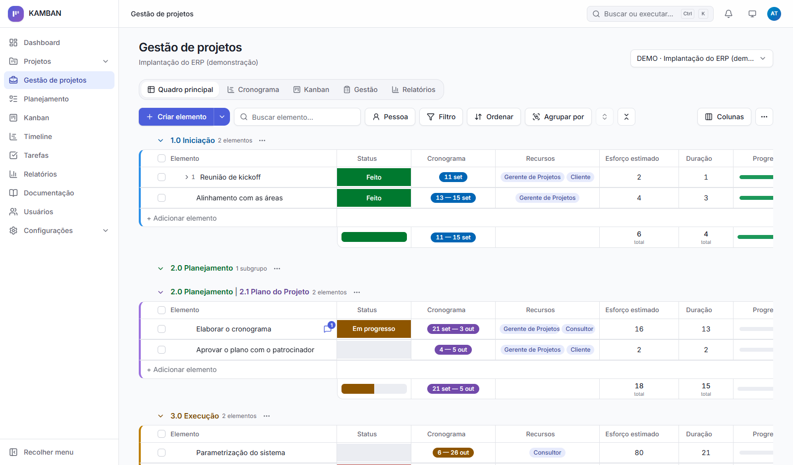
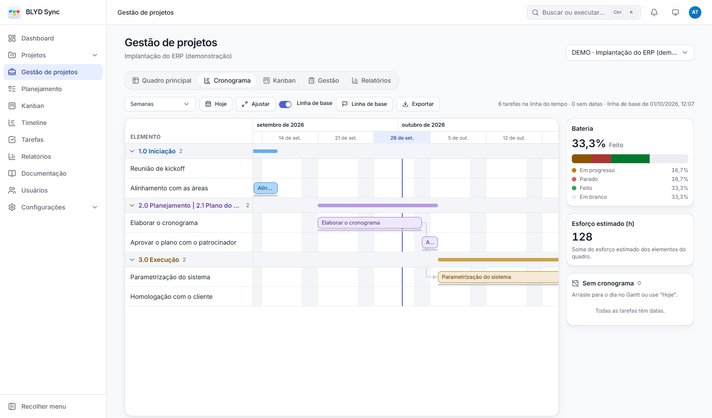
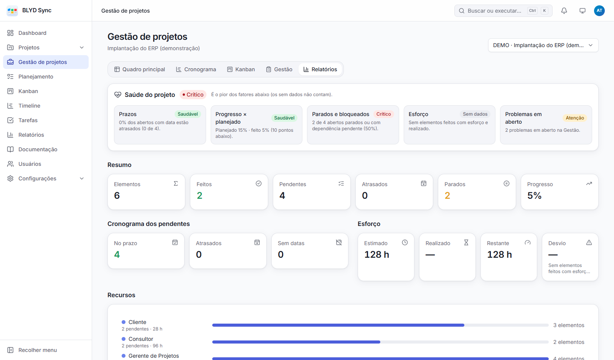
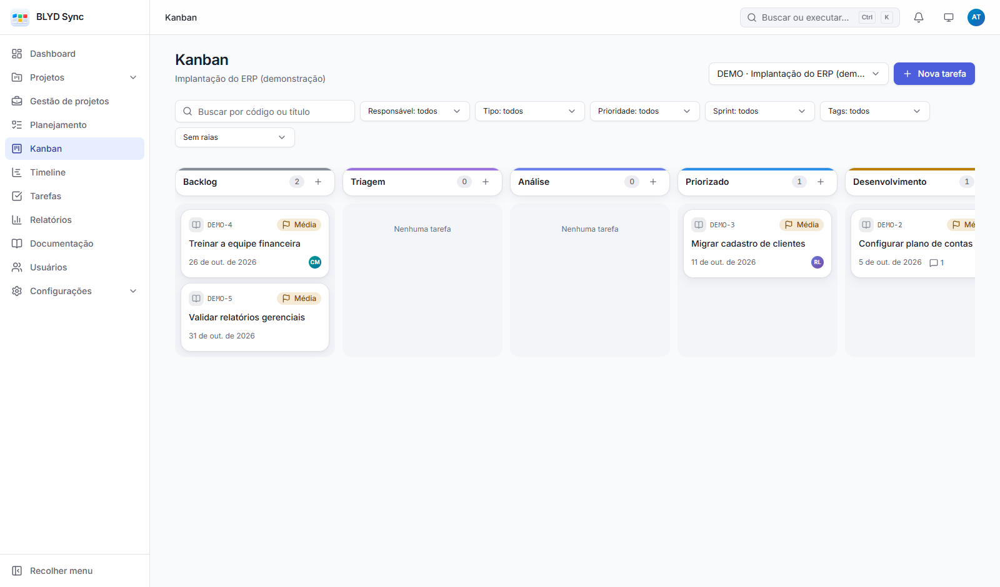
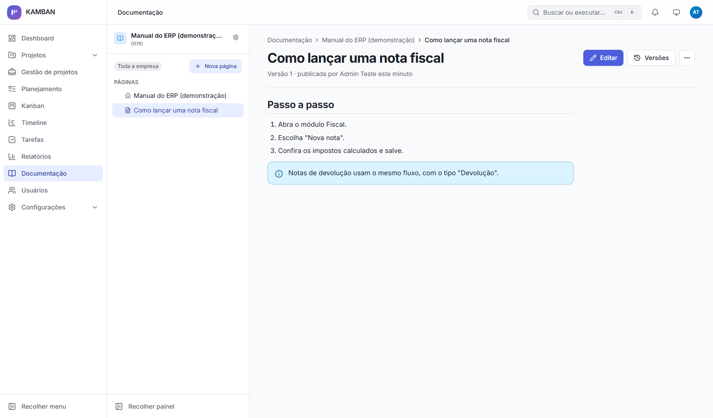

<p align="center"></p>

<h1 align="center">BLYD Sync</h1>

<p align="center"><strong>Sync projects, tasks and teams.</strong></p>

**An open source platform where the team does the work and the project gets managed, in one place.** Tasks, Kanban and sprints for day-to-day work; a Monday-style management board (phases, schedule with baseline, project health) for whoever coordinates; Confluence-style documentation to keep what the team learns. A single binary, no external services, in Portuguese, English and Spanish.

[Português](README.md) · [Apache-2.0 License](LICENSE) · [Changelog](CHANGELOG.md) · [Contributing](CONTRIBUTING.md)



> The screenshots show the Portuguese interface; switch the language from the login page or your account menu.

## Two ways of working, side by side

| | **Tasks** (the team) | **Project management** (the coordinator) |
|---|---|---|
| Purpose | Execute: what to do, who does it, which status it's in | Plan and track: phases, deliverables, deadlines, risks |
| Where | **Tasks**, **Kanban**, **Planning** and **Timeline** menus | **Project management** menu |
| Unit | Task with a type, custom fields and a status workflow | Item (and subitems) inside numbered groups (1.0, 2.1…) |
| Rules | Allowed transitions, required fields per status, WIP limits | Free status and resource labels per project, dependencies with a configurable rule |

Both live in the same **project** (same members and permissions) but stay separate: moving a task doesn't touch the management schedule, and vice versa.

## Features

**Tasks and workflow**
- Task types with their own form and **17 custom field types** (text, number, date, select, person, URL…); translated types.
- Configurable status workflow, **allowed transitions**, **required fields per status** (asks for them when moving) and **WIP limits** per column.
- Kanban with drag and drop, swimlanes and quick create; Planning with **sprints** and backlog; task Timeline with milestones.
- Comments with **@mentions** and **pasted images** (Ctrl+V), attachments with real file type checks, checklist, tags, relations (blocks, depends on, duplicates), subtasks, fork and notifications.

**Project management**
- Board with numbered groups and subgroups, items and subitems, inline cell editing, drag and drop, bulk selection, filters, group by and CSV import.
- **Custom columns** (text, number with footer sum, date, checkbox, dropdown, person, link) with type change and a preview of what would be lost.
- Item panel with updates, @mentions, pasted images and history.
- **Schedule** (Gantt with dependencies, **baseline** and export), **Kanban**, **Management** (project log and issue register) and **Reports** views with **project health** (deadlines, progress, stuck items, effort, issues).

**Documentation**
- Spaces and pages with a rich editor (tables, callouts, pasted images), autosaved drafts, versions with restore, page tree and search.

**Platform**
- **Configurable RBAC** (roles and a permission matrix, with anti-escalation rules) plus per-project roles (manager, member, viewer).
- **Audit log** of every relevant change; history on every task, item and project.
- **Reports** with clickable indicators; personal dashboard.
- Secure sessions (HttpOnly cookie, CSRF protection, CSP, progressive login lockout, active sessions).
- **Documented REST API** (`/api/v1`, OpenAPI) — the same one the interface uses — with personal **API tokens** (`Authorization: Bearer`) for scripts and integrations.
- **General settings:** platform name, logo and icon, password policy, login lockout and history retention.
- **Email:** "Forgot my password", user invitations and email notifications (SMTP with a queue and retries).
- **Realtime:** boards, tasks and notifications update on their own when someone changes something.
- Signed **webhooks** (HMAC) to notify other systems on each event, with retries and delivery history.
- Light and dark themes, mobile and desktop, accessibility checked (axe) on every screen, command palette (Ctrl/⌘+K).

<table>
  <tr>
    <td></td>
    <td></td>
  </tr>
  <tr>
    <td></td>
    <td></td>
  </tr>
</table>

## Try it in 2 minutes (Docker)

```bash
git clone <repository-url> kamban && cd kamban
cp .env.docker.example .env      # set KAMBAN_ADMIN_EMAIL and KAMBAN_ADMIN_PASSWORD
docker compose up -d
```

Open http://localhost:8090 and sign in with the email and password from `.env`. Data lives in the `kamban_data` volume. Production (HTTPS, backup, upgrades): [docs/deployment.md](docs/deployment.md) (in Portuguese).

**Demo data:** with the server running, `npm run demo` (from the repository, with `backend/.env` pointing at the server) creates the **DEMO** project — tasks, a sprint, a full management board, custom columns, log, issues, baseline and a documentation space — plus two sample people (`carla.demo@blydsync.local` and `rafael.demo@blydsync.local`, password `DemoBlydSync2026` or the one in `KAMBAN_DEMO_PASSWORD`). Running it again changes nothing.

## Development

Requirements: Node.js 22 or newer.

```bash
cd backend && npm install && npm run setup && cd ..   # dependencies + PocketBase binary
cd web && npm install && cd ..
cp backend/.env.example backend/.env                  # set KAMBAN_ADMIN_EMAIL / KAMBAN_ADMIN_PASSWORD
npm --prefix backend run create-admin                 # creates the super admin
npm run dev                                           # API :8090 + web :5173
```

Open http://localhost:5173.

| Command (root) | What it does |
|---|---|
| `npm run dev` | API and web together, with web hot reload |
| `npm run check` | lint, types and every test (unit, component and API against an isolated PocketBase) |
| `npm run e2e` | build + end-to-end browser tests (Edge or Chrome), including accessibility and responsiveness |
| `npm run build` | builds the web app into `backend/pb_public` (served by PocketBase) |
| `npm run demo` | demo data on the server from `backend/.env` |
| `npm run screenshots` | regenerates this README's images from the demo data |

**Stack:** React 19 + TypeScript + Vite, TanStack Query/Table, Radix UI, Tailwind 4 and i18next on the web; [PocketBase](https://pocketbase.io) 0.40 (Go + SQLite) with JavaScript hooks on the backend, organized as Clean Architecture (pure domain tested with `node --test`). Details in [docs/architecture.md](docs/architecture.md).

The code, commits and technical docs are written in Portuguese; issues and pull requests in English are welcome.

## Future work

- **Corporate login (SSO):** OAuth/OIDC (Microsoft, Google), then LDAP.

## License

[Apache License 2.0](LICENSE) — use, modify and distribute, including commercially, keeping the license notices and the [NOTICE](NOTICE) file. Security issues: follow the [security policy](SECURITY.md); please don't open a public issue.
